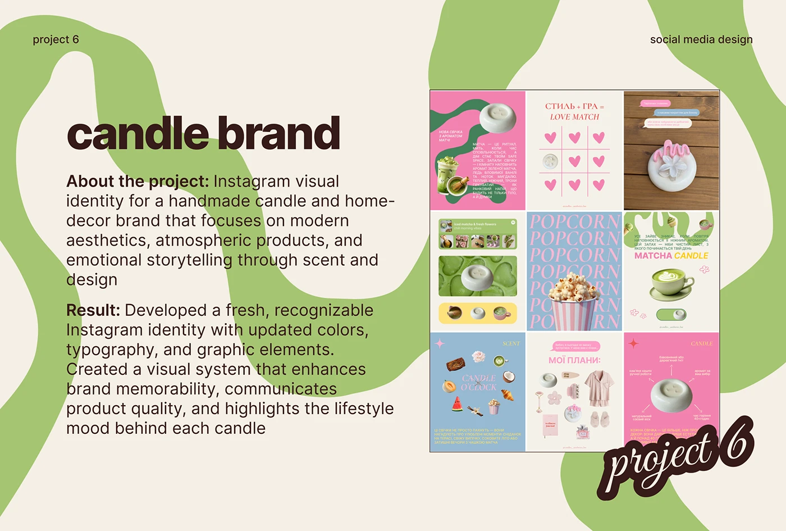

# Cream 'candle brand' slide with green swirling blobs, a feed grid and a 'project 6' sticker

**Discipline:** print-social ·  · **Design style:** Playful & Illustrated
**Tags:** case-study, social-media, cream, green, blob, feed-grid, script-sticker, candles

## What it is
A cream slide with huge green swirling ribbons across the background, small header labels, a huge chocolate 'candle brand', About and Result paragraphs and a boxed 3x3 pastel feed grid, with a script 'project 6' sticker at the corner.

## What it means
Fresh and organic; green ribbons echo the brand's shapes.

## Techniques
- Use brand blob shapes as the slide backdrop.
- Show a boxed feed grid.
- Use bold lead-ins.
- Overlay a script sticker.

## Best for
- Social media case-study slides
- Candle and home brands
- Portfolio decks

## Vocabulary
- **Blob backdrop** — Large organic shapes as background.
- **Feed grid tile** — A boxed 3x3 profile image.
- **Project sticker** — A script label numbering the project.
- **Brand shape** — A graphic shape reused across a brand.
