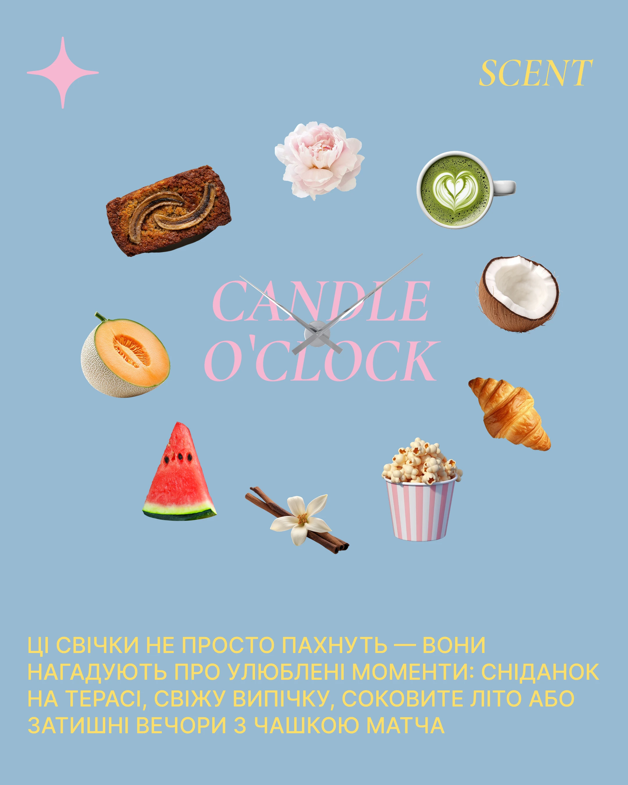

# Cutout foods arranged as clock numerals around a candle-hands clock over pastel blue

**Discipline:** print-social · **Design type:** Social promo post
**Tags:** candle, scent, clock, cutouts, blue, pink-serif, yellow-caps, food

## What it is
A dusty blue post where photo cutouts (peony, matcha, coconut, croissant, popcorn, vanilla and cinnamon, watermelon, melon, banana bread) are placed around a clock face with long silver hands over big pink italic serif 'CANDLE O'CLOCK'. A pink sparkle and yellow serif 'SCENT' sit at the corners and yellow caps text at the bottom.

## What it means
Sweet and witty; a clock of scents says 'a fragrance for every moment'.

## Techniques
- Arrange cutouts as clock numerals with real clock hands.
- Use pink italic serif over the clock centre.
- Set bottom copy in yellow caps.
- Add a single sparkle glyph.

## Best for
- Candle and fragrance posts
- Concept posts using time metaphors
- Cutout-based product families

## Vocabulary
- **Clock layout** — Items arranged around a clock face.
- **Scent cutouts** — Images of ingredients evoking a fragrance.
- **Italic serif overlay** — Elegant italic text over a graphic.
- **Sparkle glyph** — A four-point star used as decoration.
