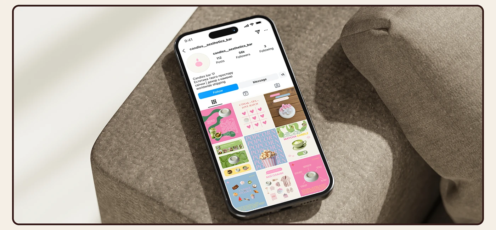

# Pastel candle-shop profile on a phone resting on a taupe woven armchair arm

**Discipline:** print-social ·  · **Design style:** Warm & Organic
**Tags:** instagram, feed-grid, mockup, pastel, taupe, chair, brown-frame, candles

## What it is
A phone showing a candle brand's profile grid of pink, green, blue and cream posts lies on the arm of a textured taupe armchair with soft shadows, framed by a thin brown rounded border.

## What it means
Soft and cosy; the neutral chair makes the pastel feed glow.

## Techniques
- Place the phone on a large neutral textile.
- Use soft window shadows.
- Frame with a brown keyline.
- Let the pastel grid be the only colour.

## Best for
- Feed presentations
- Candle and lifestyle brands
- Neutral-scene mockups

## Vocabulary
- **Neutral textile** — A plain fabric as a mockup surface.
- **Pastel feed** — A grid in soft colours.
- **Window shadow** — Soft shadow shapes from daylight.
- **Brown keyline** — A thin dark frame.
