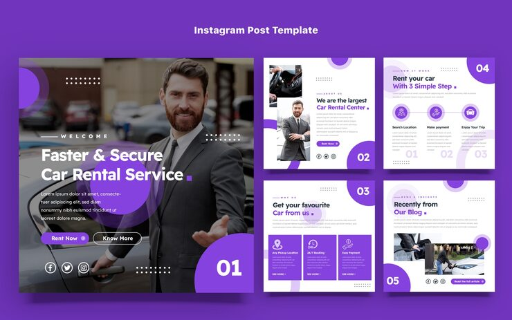

# Car rental pack in violet and white with numbered corner circles and three-step process

**Discipline:** print-social · **Design type:** Social template pack · **Design style:** Corporate & Clean-Tech
**Tags:** car-rental, violet, white, numbered, steps, services

## What it is
Five square posts: a photo-led welcome with 'Faster & Secure Car Rental Service', and white posts with violet quarter-circles holding numbers 02–05, a 'Rent your car with 3 simple steps' icon row, three violet service cards and a blog preview.

## What it means
Tidy and trustworthy; numbering turns the set into a guided story.

## Techniques
- Number posts in corner quarter-circles.
- Show a process as circled icons on a line.
- Use violet cards for features.
- Open with a strong photo post, follow with light info posts.

## Best for
- Car rental companies
- Service onboarding series
- Numbered carousels

## Vocabulary
- **Quarter circle** — A corner shape a quarter of a circle.
- **Process row** — Icons in order showing steps.
