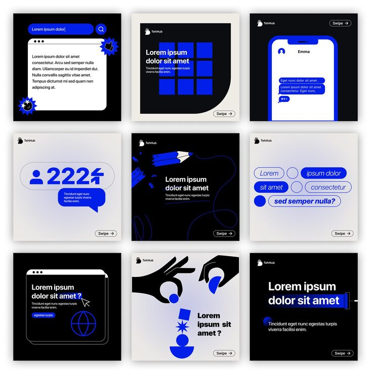

# Cream/navy/blue nine-tile brand carousel, part one

**Discipline:** print-social · **Design type:** Social carousel · **Design style:** Neo-Brutalist
**Tags:** carousel, brand system, neo-brutalist, cream, navy, blue accent

## What it is
A nine-tile Instagram carousel alternating cream, navy and near-black backgrounds, unified by one recurring blue accent color, bold sans headlines and small flat illustrative icons (hand, phone, globe).

## What it means
Rotating through only three backgrounds plus one accent color lets a nine-post carousel feel varied tile-to-tile while still reading as one unmistakable brand system.

## Techniques
- restrict a whole carousel to three backgrounds plus a single accent color
- vary content type per tile (stat, chat UI, question, illustration) while keeping the same type system
- use a consistent small logo mark and 'Swipe' cue in the same corner across every tile

## Best for
- SaaS/startup Instagram carousels
- brand system template packs
- agency case study social content

## Vocabulary
- **carousel** — a multi-slide social media post format where a viewer swipes through a sequence of images
