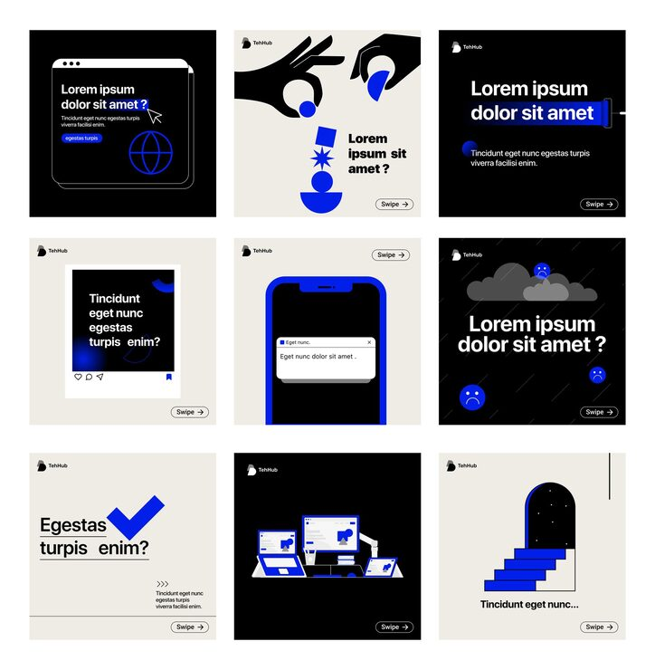

# Cream/navy/blue nine-tile brand carousel, part two

**Discipline:** print-social · **Design type:** Social carousel · **Design style:** Neo-Brutalist
**Tags:** carousel, brand system, neo-brutalist, cream, navy, blue accent

## What it is
A continuation of the same nine-tile carousel system, mixing browser-window UI, illustrated hand-and-object motifs, a phone chat mockup and a stacked-device illustration across cream/navy/black tiles.

## What it means
Showing a second full set from the same system demonstrates how far a three-color, one-type template can stretch across dozens of posts without feeling repetitive.

## Techniques
- represent abstract concepts with small symbolic illustrations (hand holding a shape) instead of stock photos
- include one browser-chrome UI tile to visually reference 'web/digital' within a print-style carousel
- vary tile content density (heavy text vs. icon-only) to create rhythm across the grid

## Best for
- SaaS/startup Instagram carousels
- brand system template packs
- digital agency portfolios

## Vocabulary
- **browser chrome** — the UI frame elements (address bar, tabs, buttons) surrounding a webpage's content area
