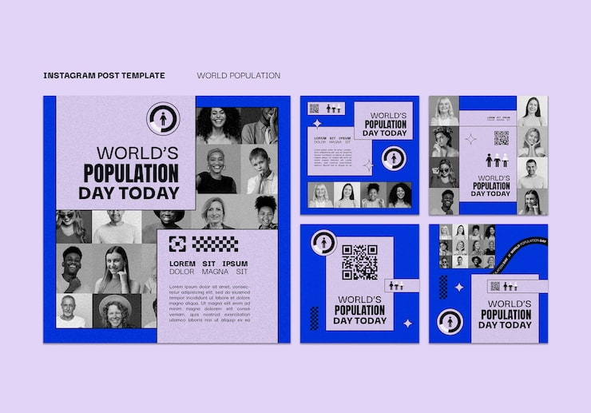

# Periwinkle World Population Day carousel with portrait photo grid

**Discipline:** print-social · **Design type:** Social carousel · **Design style:** Editorial
**Tags:** carousel, population, periwinkle, portrait grid, halftone, editorial

## What it is
A five-tile carousel on a periwinkle background for World Population Day, built around a grid of small black-and-white portrait photos, halftone-dot texture, and bold sans headlines.

## What it means
A dense grid of varied individual portraits visually embodies 'population' more directly than any icon could, turning the statistic into a literal collage of real faces.

## Techniques
- assemble a grid of many small individual portrait photos to literalize a 'population' or 'community' concept
- apply halftone dot texture over photos to unify varied source images into one visual style
- use one flat brand color as the consistent background across every tile for cohesion

## Best for
- awareness/social cause campaigns
- community or demographic-focused marketing
- editorial photo-grid carousel templates

## Vocabulary
- **halftone texture** — an image effect simulating tonal variation through varying dot sizes, referencing print/newspaper reproduction
