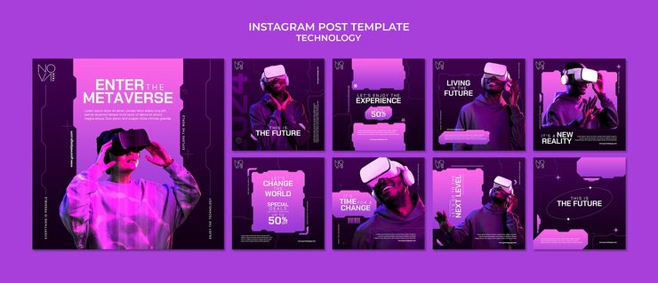

# Purple 'Enter the Metaverse' carousel with VR model photography

**Discipline:** print-social · **Design type:** Social template pack · **Design style:** Dark & Neon
**Tags:** carousel, metaverse, vr, purple duotone, instagram, photo

## What it is
A nine-tile Instagram grid on a deep purple background, using duotone-purple photography of a person wearing a VR headset alongside bold headline tiles like 'ENTER THE METAVERSE' and 'THE FUTURE'.

## What it means
Duotoning real photography into the brand's exact purple keeps photo tiles from clashing with the flat typographic tiles around them in the same grid.

## Techniques
- duotone photography into the exact brand accent color so photo and flat tiles blend seamlessly
- repeat one strong lead phrase (metaverse/future) across multiple tiles for message reinforcement
- frame the cover tile with a bold left-aligned headline for a strong grid-view first impression

## Best for
- metaverse/VR brand campaigns
- dark-mode photography-led carousels
- tech product launch social kits

## Vocabulary
- **duotone photography** — photography color-graded into two tones, typically to match a strict brand palette
