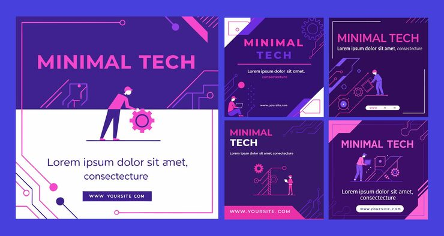

# Purple/pink tech carousel variant with worker illustration lead tile

**Discipline:** print-social · **Design type:** Social carousel · **Design style:** Dark & Neon
**Tags:** carousel, tech, purple pink, flat illustration, gear icon, circuit pattern

## What it is
A companion five-tile carousel from the same Minimal Tech brand, reordering the lead tile to foreground the illustrated worker beside a large gear icon, with the same diagonal stripe and circuit-pattern system.

## What it means
Reordering which tile leads a carousel while keeping the same visual system shows how one brand kit can generate multiple ready-to-post variants without new design work.

## Techniques
- swap the lead/cover tile of a carousel to test different first impressions from the same asset set
- pair a gear icon directly beside a character illustration to concretely signal 'engineering/build'
- maintain identical color, type and pattern rules across variant tile orderings for brand consistency

## Best for
- tech startup social carousels
- developer/SaaS marketing content
- template packs needing multiple cover options

## Vocabulary
- **cover tile** — the first slide of a multi-slide carousel post, designed to earn the initial tap/swipe
