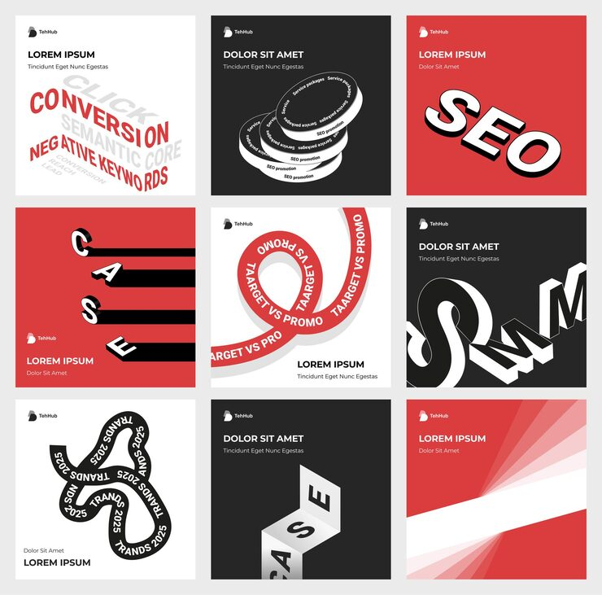

# Red/white/black carousel with warped typographic motion

**Discipline:** print-social · **Design type:** Social carousel · **Design style:** Neo-Brutalist
**Tags:** carousel, typography, warped text, red, neo-brutalist, motion

## What it is
A nine-tile carousel in red, white and black using distorted, curved and isometric typography treatments (spinning ribbons, folded 3D words) to spell out marketing terms like SEO, CASE and CONVERSION.

## What it means
Treating each keyword as its own typographic illustration turns plain marketing jargon into something visually memorable and shareable, rather than default flat labels.

## Techniques
- warp or curve type along a path to add motion and personality to a single word
- render a word in isometric 3D fold to make it feel like a physical object
- keep the palette to red/white/black across every tile so wildly different type treatments stay unified

## Best for
- marketing agency brand carousels
- typography-led social content
- case study or portfolio teaser posts

## Vocabulary
- **warped type** — typography distorted along a curve or path rather than set on a straight baseline
