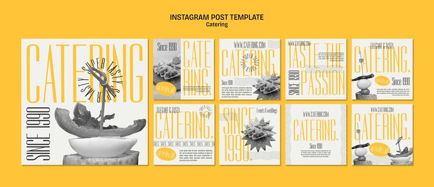

# Catering pack with towering yellow condensed type, greyscale canapés and a spinning text badge

**Discipline:** print-social · **Design type:** Social template pack · **Design style:** Editorial
**Tags:** catering, food, yellow, condensed-type, greyscale, circular-text

## What it is
Ten off-white posts with huge thin yellow condensed words ('CATERING', 'TASTE THE PASSION', 'SINCE 1990') running vertically and horizontally, greyscale cut-out canapés and skewers, a circular 'Super Tasty' text ring, repeated 'Since 1990' lines, wavy rules and yellow oval badges.

## What it means
Stylish and editorial; greyscale food plus one yellow feels like a fashion magazine for food.

## Techniques
- Make food greyscale and type the only colour.
- Set a word in tall condensed caps that fills the height.
- Wrap a slogan around a circle as a badge.
- Repeat small text lines as texture.

## Best for
- Catering and events
- Restaurants with editorial branding
- Food magazines

## Vocabulary
- **Circular text** — Text set along a circle path.
- **Condensed display** — Very narrow, tall headline type.
