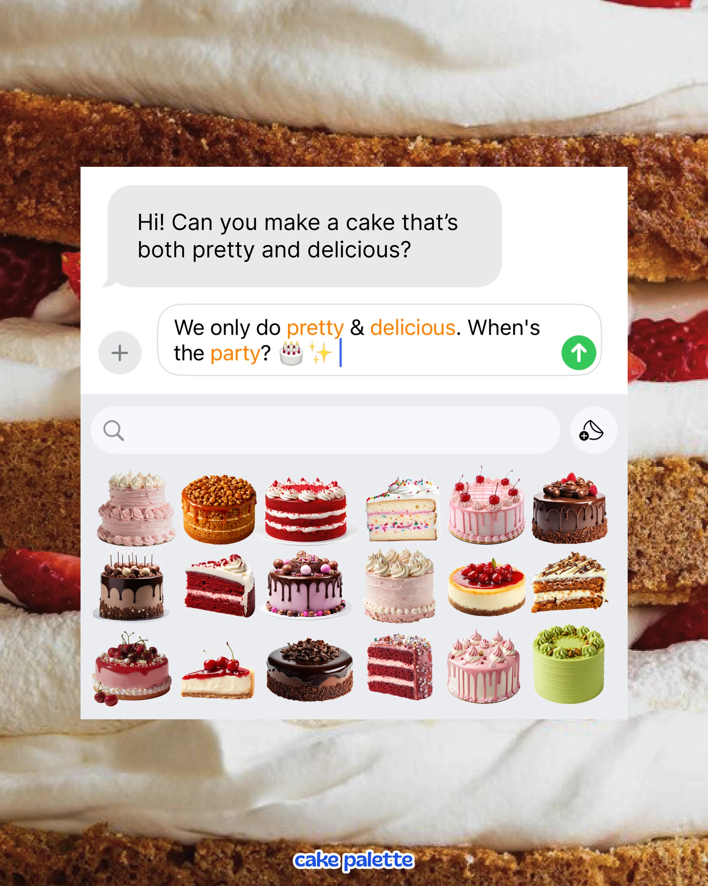

# Message thread with cake stickers in an emoji tray over a macro layer-cake photograph

**Discipline:** print-social · **Design type:** Social promo post
**Tags:** ui-parody, chat, stickers, cakes, macro-photo, orange-highlight, food, imessage

## What it is
A macro photo of cream and sponge layers with a white iMessage-style panel: a grey bubble asking for a pretty and delicious cake, a reply in the input with orange highlighted words 'pretty', 'delicious' and 'party', a search bar and a sticker tray of eighteen cut-out cakes, with a small blue logo at the bottom.

## What it means
Witty and mouth-watering; the sticker tray turns a cake menu into emoji.

## Techniques
- Parody a messaging app with a sticker tray as the product grid.
- Highlight key words in orange within the reply.
- Use a macro food photo as the backdrop.
- Keep the panel white so cutouts pop.

## Best for
- Bakery menus and product ranges
- UI-parody posts
- Sticker-grid layouts

## Vocabulary
- **Sticker tray** — A grid of stickers like a keyboard panel.
- **Message bubble** — A grey rounded chat message.
- **Input highlight** — Key words coloured in a reply.
- **Macro backdrop** — An extreme close-up photo behind a panel.
