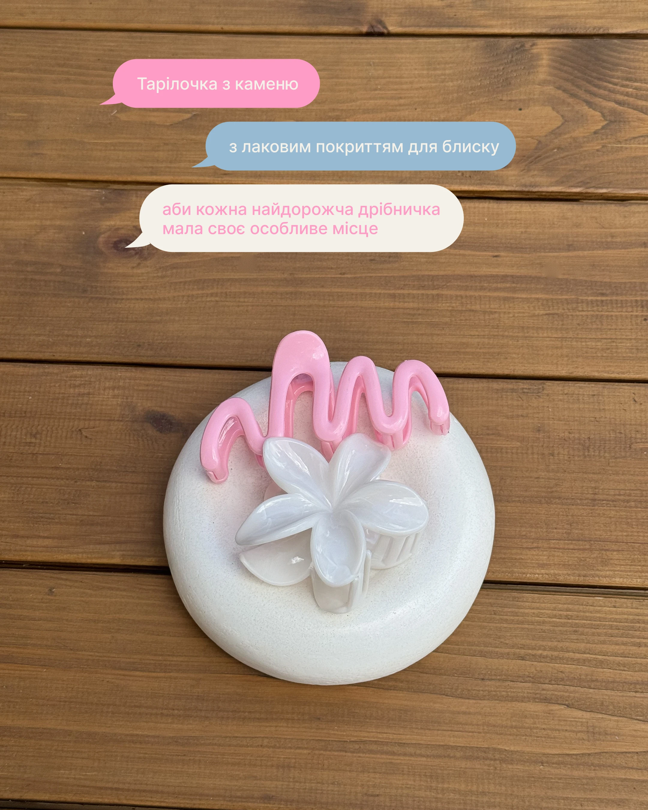

# Product photo on wood with three chat-bubble captions in pink, blue and cream

**Discipline:** print-social ·  · **Design style:** Warm & Organic
**Tags:** product, chat-bubbles, pastel, wood, hair-clips, ceramic-dish, minimal, cyrillic

## What it is
A top-down photo of a white stone dish holding a pink squiggle hair claw and a white flower claw on wooden planks. Three iMessage-style speech bubbles in pink, dusty blue and cream stack across the top carrying the caption text.

## What it means
Casual, intimate and conversational; the product feels described by a friend.

## Techniques
- Set captions as offset chat bubbles instead of headlines.
- Use pastel bubble colours that echo the product.
- Keep the photograph unretouched and warm.
- Alternate bubbles left and right for a dialogue rhythm.

## Best for
- Handmade and accessory brands
- Product story posts
- Minimal captions over photography

## Vocabulary
- **Chat-bubble caption** — Text set in message-app speech bubbles.
- **Dialogue rhythm** — Bubbles alternating sides like a conversation.
- **Colour echo** — UI colours picked from the product.
- **Flat lay** — A product photographed from directly above.
