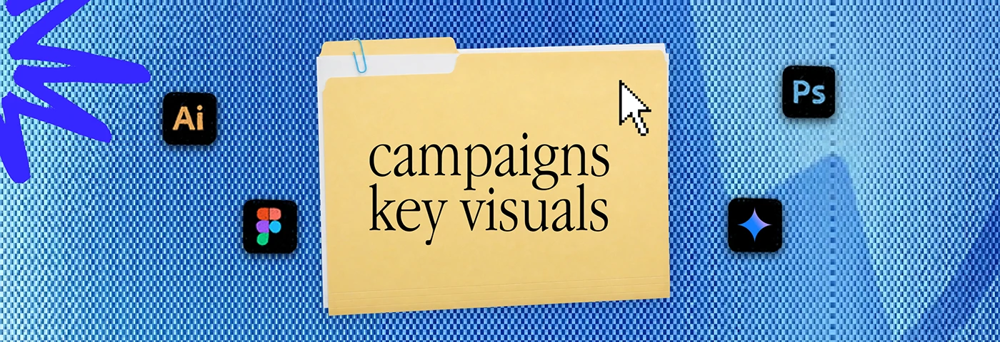

# Blue checker-pattern banner with a 'campaigns key visuals' folder

**Discipline:** print-social ·  · **Design style:** Retro & Pixel
**Tags:** banner, checker, halftone, blue, folder, scribble, desktop-metaphor, series

## What it is
A wide banner with a fine blue and white checkerboard texture instead of dots, a manila folder labelled 'campaigns key visuals', a blue scribble at the left edge, a pixel cursor and four tool icons.

## What it means
Digital and crisp; the checker pattern reads like a screen grid or pixel mesh.

## Techniques
- Swap halftone dots for a fine checkerboard to change the texture but keep the system.
- Keep the folder and cursor composition identical.
- Put a dark blue swoosh across the pattern for depth.
- Use a scribble as a sticker-like accent.

## Best for
- Series banners with variations
- Creative service menus
- Digital-first profiles

## Vocabulary
- **Checker texture** — A fine pattern of alternating squares.
- **System variation** — Changing one element while keeping the rest.
- **Folder tab title** — A category label on a folder.
- **Pixel mesh** — A grid of pixels as decoration.
