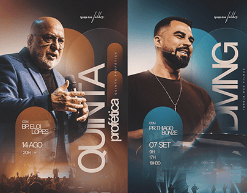

# Two event posters with cutout speakers, vertical cream titles and arch shapes

**Discipline:** print-social ·  · **Design style:** Photographic & Cinematic
**Tags:** event, church, orange, teal, vertical-title, portrait-cutout, arches, gradient

## What it is
Two side-by-side flyers: one orange-brown, one teal, each with a cut-out preacher, a giant vertical cream title along the edge ('QUINTA profética', 'DOMINGO'), a rounded arch behind the speaker, small name and date text and a crowd silhouette at the base.

## What it means
Warm and reverent yet modern; vertical type and arches feel architectural.

## Techniques
- Run huge vertical titles along the poster edge.
- Place an arch shape behind the cutout speaker.
- Use a warm/cool colourway pair for two events.
- Add the crowd photo at the bottom for scale.

## Best for
- Church and community events
- Speaker announcement series
- Two-tone gradient posters

## Vocabulary
- **Vertical title** — Text rotated 90 degrees along an edge.
- **Arch backdrop** — A rounded-top shape behind a subject.
- **Warm/cool pair** — Two designs in opposite colour temperatures.
- **Crowd base** — A photo of an audience at the bottom.
