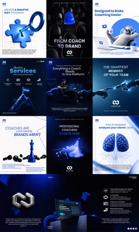

# Cobalt and white coaching platform posts with 3D objects

**Discipline:** print-social ·  · **Design style:** 3D & Surreal
**Tags:** coaching, cobalt, 3d-objects, brain, chess, puzzle, grid, platform-launch

## What it is
A 3x3 grid of posts in deep blue and white, each with a hero 3D object (puzzle piece, chess pieces, brain, mascot) or duotone photo, bold sans headlines and a small logo.

## What it means
Professional and inventive; consistent blue with unique 3D icons explains abstract coaching ideas.

## Techniques
- Assign each message a glossy 3D metaphor object.
- Alternate dark and white posts for rhythm.
- Use duotone photography in the brand blue.
- Keep the same logo placement everywhere.

## Best for
- Platform and service launches
- Coaching and SaaS branding
- Explaining abstract ideas visually

## Vocabulary
- **3D metaphor** — A rendered object symbolising an idea.
- **Duotone** — An image tinted with two colours.
- **Alternating grid** — Dark and light cards interleaved.
- **Logo anchor** — A logo placed identically in each post.
