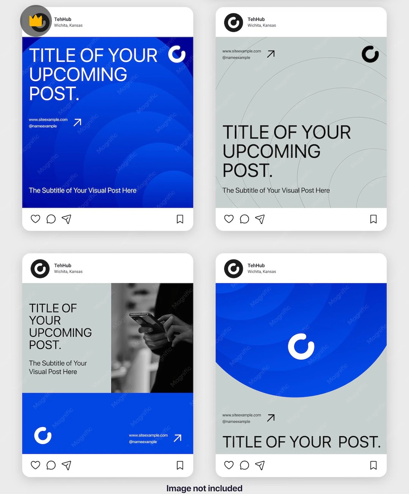

# Cobalt Arc Post Frames (Cropped View)

**Discipline:** print-social · **Design type:** Feed mockup
**Tags:** instagram-frames, cobalt, grey, concentric-arcs, ring-logo, template, cropped

## What it is
A cropped screenshot of the same four Instagram frames: a cobalt post with a white headline over concentric arcs, a grey post with fine arcs, a split post with a phone photo above a cobalt band and a grey post with a big cobalt half-disc holding a ring logo, labelled 'Image not included'.

## What it means
A single circle motif in two colours gives four different layouts one consistent identity.

## Techniques
- Concentric arc motif across posts
- Cobalt and grey as the only colours
- Ring logo repeated in each post
- Real Instagram frame chrome
- Light sans headlines

## Best for
- Minimal social template previews
- Blue and grey business posts
- Motif-driven post systems

## Vocabulary
- **Arc motif** — Concentric curves used as a signature pattern.
- **Placeholder image note** — A caption stating that a photo is not part of the template.
- **Post chrome** — The platform's header and action icons around a post.
