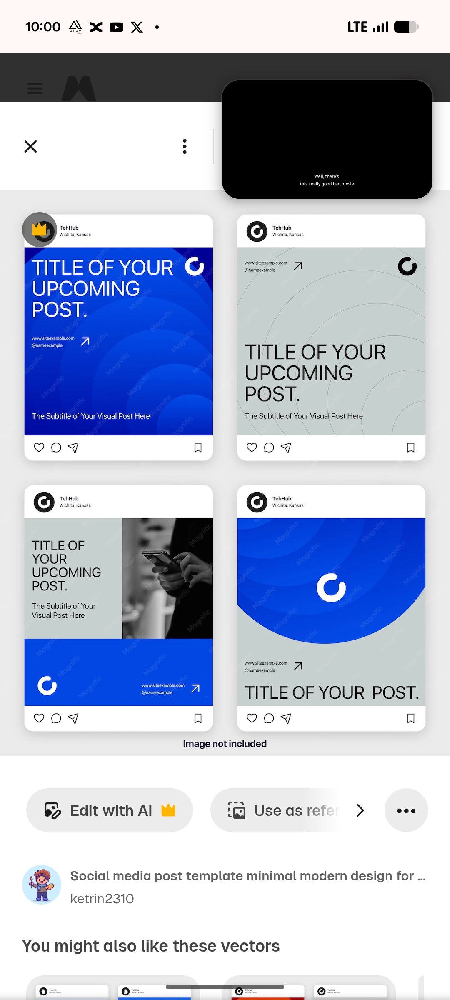

# Cobalt and Grey Concentric Arc Post Frames

**Discipline:** print-social ·  · **Design style:** Geometric & Bauhaus
**Tags:** instagram-frames, cobalt, grey, concentric-arcs, circle-logo, title-post, template

## What it is
Four Instagram frames on light grey: a cobalt post with a white headline and concentric arcs, a grey post with fine arcs and a black headline, a split post with a phone-in-hand photo above a cobalt band and a grey post with a large cobalt half-disc holding a ring logo above a one-line title.

## What it means
One arc motif reused in cobalt and grey gives a set cohesion, and the ring logo repeats in each frame.

## Techniques
- Concentric arcs as the shared background
- Cobalt and pale grey as the two-colour base
- Ring logo repeated as a mark
- Monochrome photo for the split post
- Light headline weights for a calm tone

## Best for
- Minimal social templates
- Blue and grey business posts
- Motif-driven post systems

## Vocabulary
- **Arc motif** — Concentric curved lines used as a signature pattern.
- **Half-disc** — A semicircle used as a bold shape.
- **Two-colour base** — A system built from two main colours.
