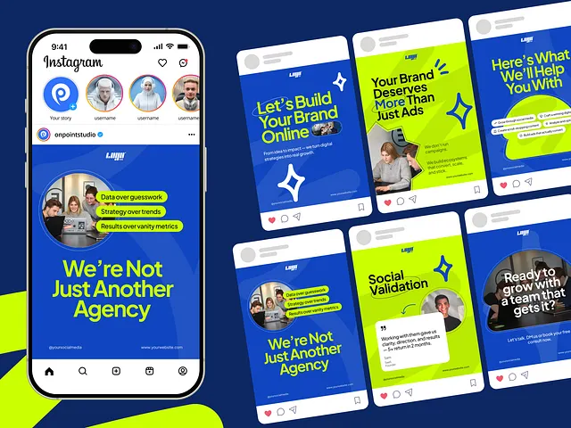

# Cobalt and lime agency carousel with a circular photo and check-pills

**Discipline:** print-social · **Design type:** Social carousel
**Tags:** agency, carousel, cobalt, lime, circle-photo, pills, phone-mockup, sparkles

## What it is
A navy background with a phone showing an Instagram profile and a large post 'We're Not Just Another Agency', plus six smaller posts in cobalt and lime. Each has bold headline text, a circular team photo with lime label pills, a four-point sparkle shape and a footer strip.

## What it means
Confident and modern; the lime highlights on cobalt feel like a fresh digital agency.

## Techniques
- Crop a team photo into a circle with pills attached.
- Turn key phrases into lime labels with dark text.
- Use large four-point sparkle icons as a repeated glyph.
- Alternate cobalt and lime cards for rhythm.

## Best for
- Agency and consultancy social posts
- Service explainers
- Template packs

## Vocabulary
- **Circle crop** — A photo masked into a circle.
- **Label pill** — A coloured capsule over a photo.
- **Sparkle glyph** — A four-point star used as a decorative icon.
- **Alternating cards** — Posts that switch between two brand colours.
