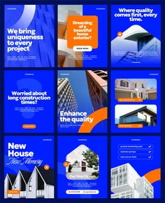

# Cobalt and orange building posts with arcs, photos and bold sans

**Discipline:** print-social ·  · **Design style:** Corporate & Clean-Tech
**Tags:** architecture, construction, cobalt, orange, arcs, photo-crops, templates, grid

## What it is
A 3x3 grid of posts in deep blue with orange curved swooshes and building photos in tilted or arch crops. Headlines are bold white sans with orange highlights and a script phrase 'New Memory'.

## What it means
Confident and constructive; blue-orange contrast feels dynamic and trustworthy.

## Techniques
- Use big orange arcs to cut across blue cards.
- Crop architecture photos into arches and diagonal panels.
- Mix bold sans headlines with one script phrase.
- Alternate photo-heavy and text-heavy posts.

## Best for
- Construction, real-estate and design studios
- Social template packs
- Service posts using blue and orange

## Vocabulary
- **Arc swoosh** — A wide curved band crossing a layout.
- **Arch crop** — A photo masked with a rounded top.
- **Complementary accent** — Orange used against blue for contrast.
- **Script phrase** — A short script insert in a sans headline.
