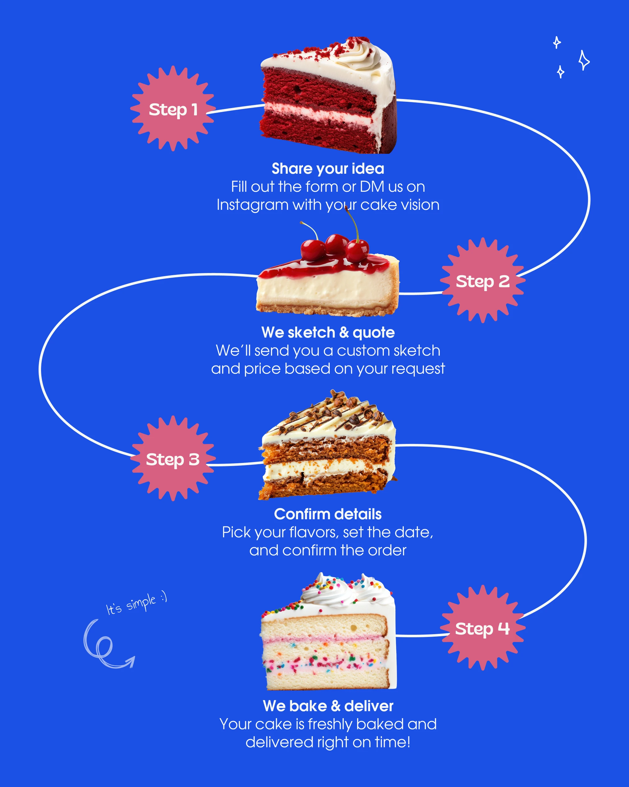

# Four-step cake ordering guide on a wavy white path with pink starburst numbers

**Discipline:** print-social · **Design type:** Social infographic
**Tags:** infographic, process, cobalt, pink, starburst, cake-slices, path, steps

## What it is
A cobalt 4:5 post where a winding white line links four cake-slice cut-outs, each with a pink serrated 'Step N' badge and a bold title with a one-sentence description in white. A small handwriting note 'It's simple :)' with an arrow sits at bottom left.

## What it means
Clear and appetising; the path makes a process read as an easy journey.

## Techniques
- Use one continuous curved line to link steps in a zigzag.
- Show a different product image at each step.
- Number steps with pink starburst badges.
- Add a handwritten reassurance note.

## Best for
- How-to-order and process explainers
- Food and service businesses
- Step-by-step carousels

## Vocabulary
- **Path infographic** — Steps connected by a winding line.
- **Step badge** — A shaped label with a step number.
- **Zigzag flow** — Alternating left and right placement of steps.
- **Handwritten note** — A casual script annotation.
