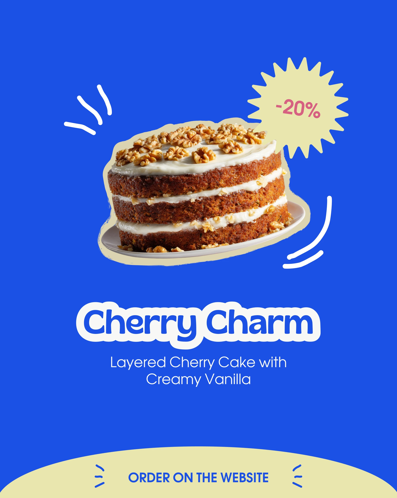

# Cobalt product post with cream-outlined cake, discount starburst and arc footer

**Discipline:** print-social · **Design type:** Social promo post
**Tags:** product, cobalt, cream, starburst, sticker-outline, bakery, arc-footer, bubble-type

## What it is
A 4:5 cobalt post with a cut-out cake outlined in cream, a cream starburst '-20%', white hand-drawn motion strokes, a bubble-outlined name 'Cherry Charm' with a caption, and a cream arc at the bottom holding the call to action.

## What it means
Simple, appetising and clear; the limited palette feels like a confident brand system.

## Techniques
- Outline the cutout product in a thin cream stroke to make a sticker.
- Use a spiky badge for discounts.
- Add short scribbled motion lines for energy.
- Close with a shallow arc in the secondary colour for the CTA.

## Best for
- Food product promos
- Retail sale posts
- Any brand with a two-colour system

## Vocabulary
- **Motion strokes** — Short lines suggesting movement.
- **Arc footer** — A curved panel at the bottom holding a call to action.
- **Two-colour system** — A design using just two brand colours plus imagery.
- **Product sticker** — A cutout with a border.
