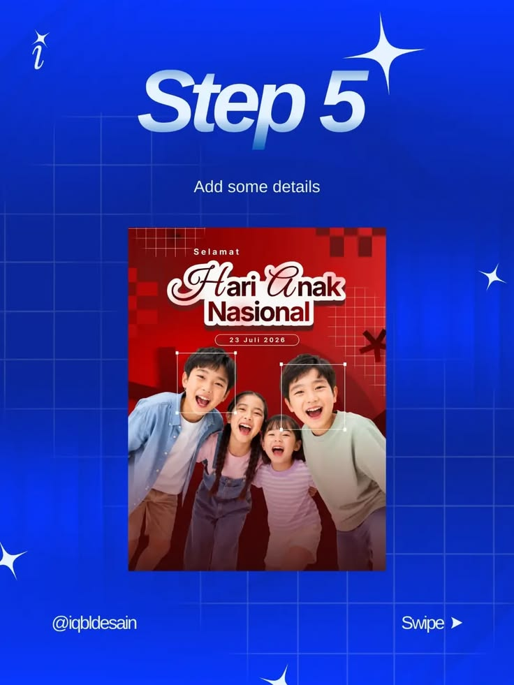

# Cobalt Step Five Tutorial Slide

**Discipline:** print-social · **Design type:** Social educational post
**Tags:** tutorial, cobalt, step, grid, sparkles, poster, swipe

## What it is
A saturated blue slide with big glossy italic 'Step 5', a subtitle 'Add some details', a framed poster preview of smiling children with face-selection boxes, sparkle stars and a swipe cue.

## What it means
Glossy chrome-like numerals and sparkles feel fun and current, and the preview shows the exact result of the step.

## Techniques
- Chrome gradient on the step title
- Faint grid and four-point sparkle stars
- Preview of the work in progress at centre
- Selection boxes drawn on the preview to teach where to act
- Swipe prompt and author handle in the footer

## Best for
- Design tutorial carousels
- Poster-making lessons
- Educational social posts

## Vocabulary
- **Chrome type** — Lettering with a metallic gradient highlight.
- **Sparkle** — A four-point star used as a decorative accent.
- **Swipe cue** — A small indicator prompting the next carousel slide.
