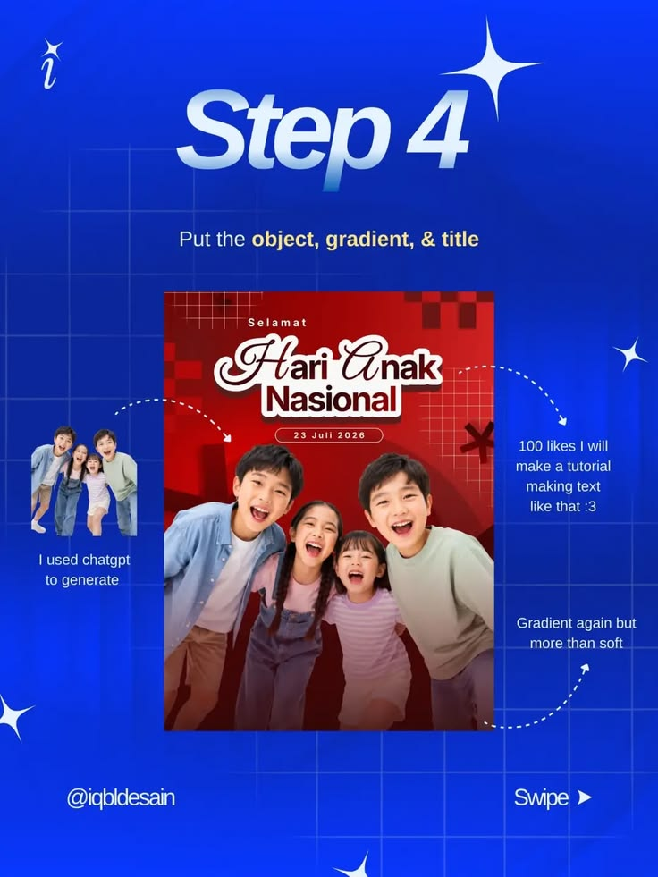

# Step 4 Object, Gradient and Title Tutorial

**Discipline:** print-social ·  · **Design style:** Gradient & Aurora
**Tags:** tutorial, cobalt, step-4, poster, annotation, photo, swipe

## What it is
A cobalt slide with glossy 'Step 4', instructions to add an object, gradient and title, a finished red poster of laughing children with a script title, and dotted arrows pointing to a small reference photo and notes about gradients.

## What it means
Showing the near-finished poster with arrows to its ingredients makes the process feel reproducible, and casual notes add personality.

## Techniques
- Dotted arrows linking notes to poster parts
- Reference cut-out shown beside the result
- Friendly handwritten-style notes
- Script title with white outline on the poster
- Consistent tutorial chrome and swipe cue

## Best for
- Poster design tutorials
- Step-by-step carousels
- Showing process ingredients

## Vocabulary
- **Ingredient callout** — A note and arrow pointing to one element used in a design.
- **Script title** — A display headline in a script typeface.
- **Outline stroke** — A border around lettering to lift it from a background.
