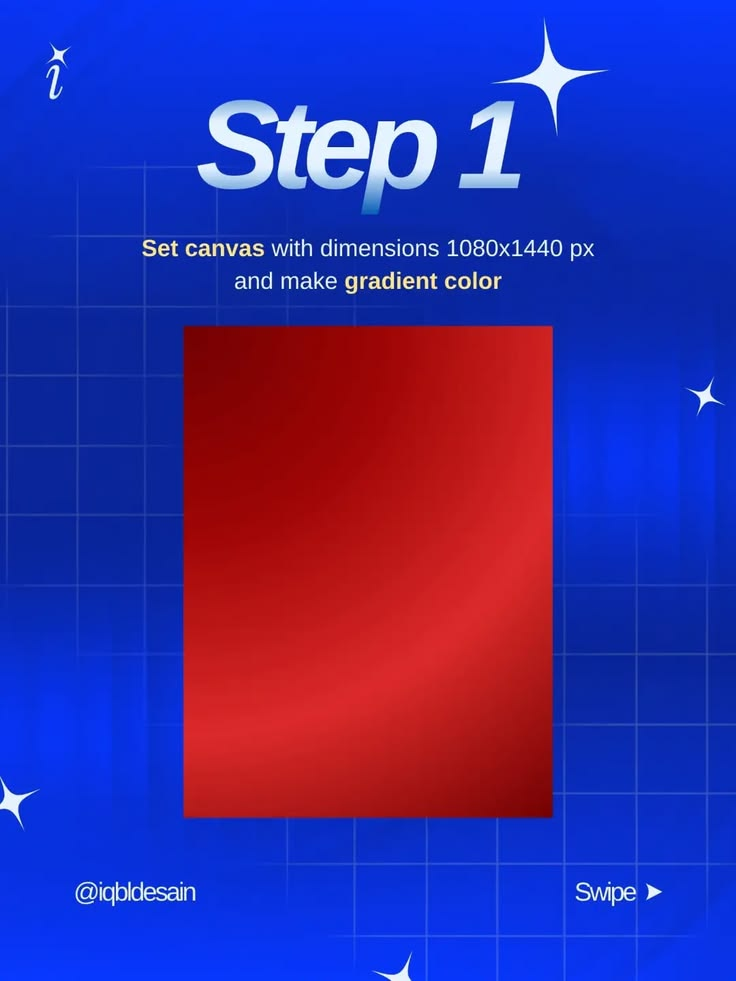

# Step 1 Canvas and Gradient Tutorial

**Discipline:** print-social ·  · **Design style:** Gradient & Aurora
**Tags:** tutorial, cobalt, step-1, gradient, grid, sparkles, swipe

## What it is
A saturated blue slide with glossy 'Step 1', an instruction to set the canvas size and make a gradient, a red gradient rectangle as the demo, sparkle stars, faint grid and a swipe cue.

## What it means
Showing the plain red canvas at the very start of a poster tutorial makes the build feel achievable.

## Techniques
- Glossy chrome step title
- Key words highlighted in cream
- Plain gradient shape as a step-one visual
- Four-point sparkles and grid
- Author handle and swipe prompt

## Best for
- Poster tutorial carousels
- Beginner design lessons
- Series openers

## Vocabulary
- **Step title** — A large label marking the current tutorial step.
- **Key word highlight** — Making important words a different colour.
- **Canvas setup** — Choosing the size and background before designing.
