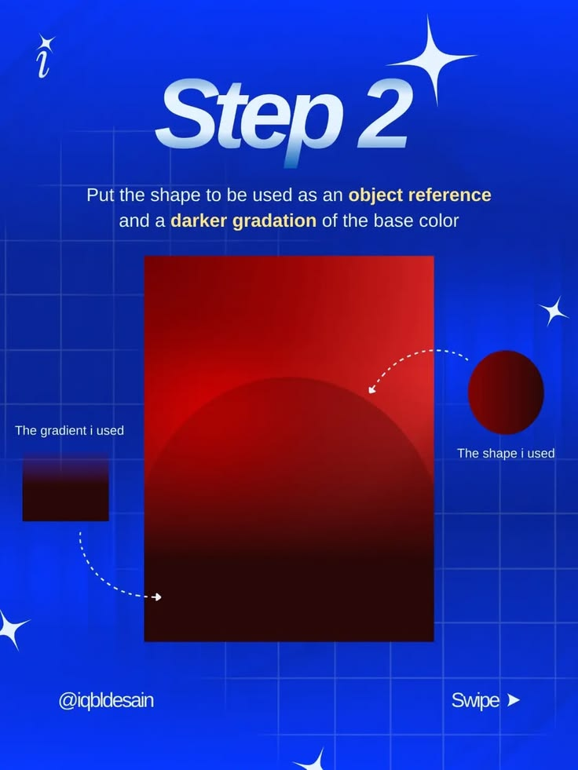

# Step 2 Shape and Gradient Reference

**Discipline:** print-social ·  · **Design style:** Gradient & Aurora
**Tags:** tutorial, cobalt, step-2, gradient, arrows, annotation, swipe

## What it is
A cobalt slide with glossy 'Step 2', instructions to add an object reference and darker gradation, a red canvas with a dark dome shape, and dotted arrows from small swatches labelled 'The gradient I used' and 'The shape I used'.

## What it means
Showing the exact swatches beside the canvas makes the step reproducible, and dashed arrows guide the eye.

## Techniques
- Dotted arrows linking swatches to the canvas
- Small labelled reference swatches
- Glossy chrome step title
- Cream key words
- Consistent tutorial chrome across steps

## Best for
- Design tutorials
- Step-by-step carousels
- Showing gradient recipes

## Vocabulary
- **Reference swatch** — A small sample showing the exact colour or shape used.
- **Dotted arrow** — A dashed arrow linking a note to its target.
- **Gradation** — A gradual change from light to dark of a colour.
