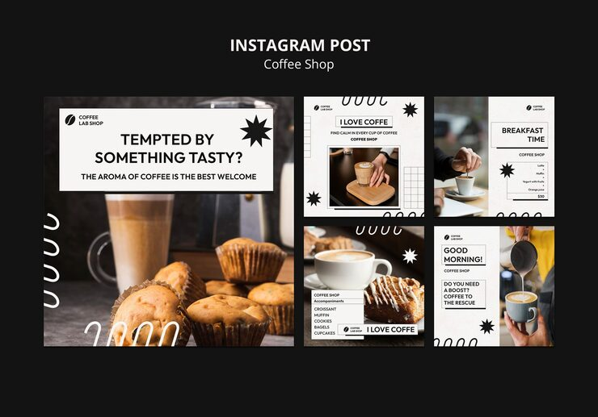

# Coffee shop pack with off-white boxed headlines, black starbursts and loop doodles

**Discipline:** print-social · **Design type:** Social template pack · **Design style:** Editorial
**Tags:** coffee, cafe, food, starburst, boxed-type, black-and-white, instagram

## What it is
Five posts mixing warm coffee and pastry photos with off-white panels holding boxed uppercase headlines ('Tempted by something tasty?', 'Breakfast Time', 'Good Morning!'), black eight-point starbursts, loop-line doodles, grids and a small menu list.

## What it means
Crisp and café-cool; the monochrome graphic layer lets warm food photos glow.

## Techniques
- Overlay a light panel with boxed text on a full-bleed photo.
- Use black starbursts as punctuation.
- Add loop-line doodles along edges.
- Put a mini menu in ruled rows.

## Best for
- Cafés and bakeries
- Breakfast menus
- Food social series

## Vocabulary
- **Boxed headline** — A headline set inside a thin rectangle.
- **Full-bleed** — An image running to the edges of the frame.
