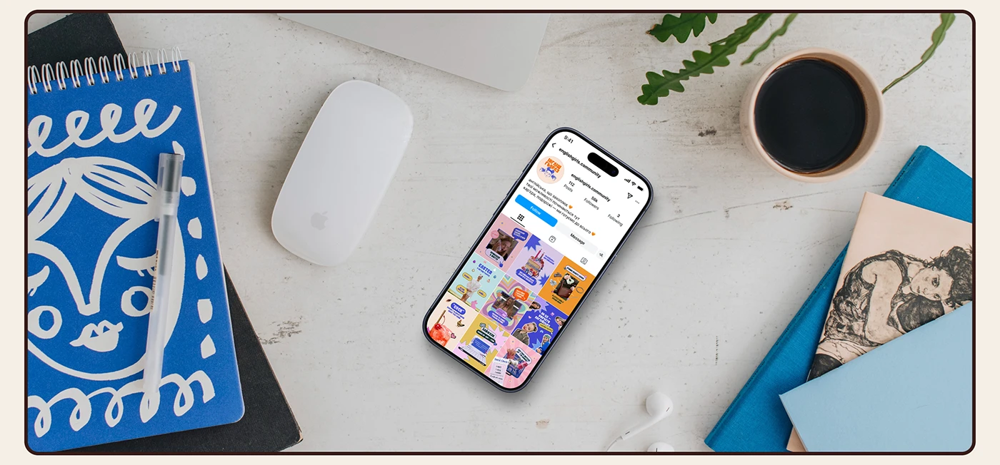

# Community Instagram profile on a phone beside a mouse, coffee, notebook and books

**Discipline:** print-social ·  · **Design style:** Warm & Organic
**Tags:** instagram, feed-grid, flat-lay, desk, blue-notebook, coffee, cream-frame, education

## What it is
A wide top-down desk scene with a phone showing a colourful profile grid, a white mouse, a black coffee, fern leaves, headphones, a blue sketch notebook with a white face doodle and stacked books, in a thin brown rounded frame.

## What it means
Friendly and studio-like; desk props create a working-day story.

## Techniques
- Style a flat lay with props in the brand blue.
- Put the phone off-centre and tilted.
- Use light wood or plaster for a neutral base.
- Frame with a brown keyline.

## Best for
- Social media portfolio mockups
- Creative-lifestyle brands
- Desk flat-lay scenes

## Vocabulary
- **Desk flat lay** — A top-down arrangement of desk objects.
- **Prop palette** — Props chosen to match brand colours.
- **Tilted device** — A phone placed at an angle.
- **Brown keyline** — A thin dark frame around an image.
