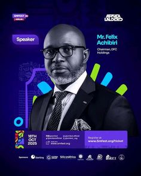

# Conference speaker card with cut-out portrait and confetti stripes

**Discipline:** print-social ·  · **Design style:** Photographic & Cinematic
**Tags:** event, speaker-card, indigo, lime, portrait, sponsor-strip, conference

## What it is
A dark indigo card with a cut-out portrait of a suited man with glasses, a violet 'Speaker' pill, name and title in white, a date block and registration link, coloured pill confetti behind his shoulder, and a row of sponsor logos at the base.

## What it means
Professional but festive; bright pill shapes lend energy to a formal portrait.

## Techniques
- Cut out the subject and let coloured pill shapes peek behind his shoulders.
- Use a small role pill above the name as a label.
- Set date and link in a bordered block at the lower left.
- Close with a sponsor logo strip.

## Best for
- Conference and summit speaker announcements
- Panel and webinar promotion
- Templated speaker series

## Vocabulary
- **Speaker card** — A graphic introducing one event speaker.
- **Confetti pills** — Small rounded capsules scattered as decoration.
- **Sponsor strip** — A row of partner logos.
- **Role pill** — A rounded label naming a role.
