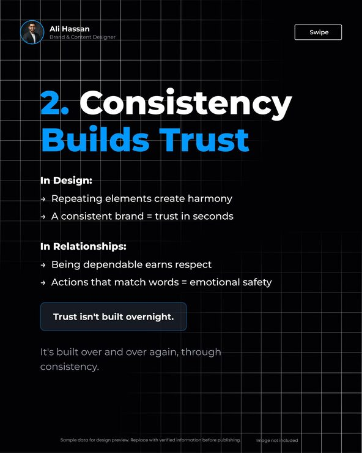

# '2. Consistency Builds Trust' carousel slide on a fading black grid with blue numbering

**Discipline:** print-social · **Design type:** Social educational post · **Design style:** Dark & Neon
**Tags:** personal-brand, carousel, black, blue, grid, tips, linkedin

## What it is
A portrait slide on black with a faint white grid, author avatar and 'Swipe' button top, a large headline with '2.' and 'Builds Trust' in blue, two arrow-bullet lists (In Design, In Relationships), a dark callout box 'Trust isn't built overnight.' and a grey closing line.

## What it means
Thoughtful and authoritative; the grid and numbering feel like a designer's notebook.

## Techniques
- Number carousel slides in the accent colour.
- Use a faint grid as a background texture.
- Pull one sentence into a bordered callout.
- Put the author's avatar in the header for a personal voice.

## Best for
- Personal brand carousels
- Design tips content
- LinkedIn thought leadership

## Vocabulary
- **Callout box** — A framed line that stands out from the body.
- **Grid texture** — A faint line grid behind content.
