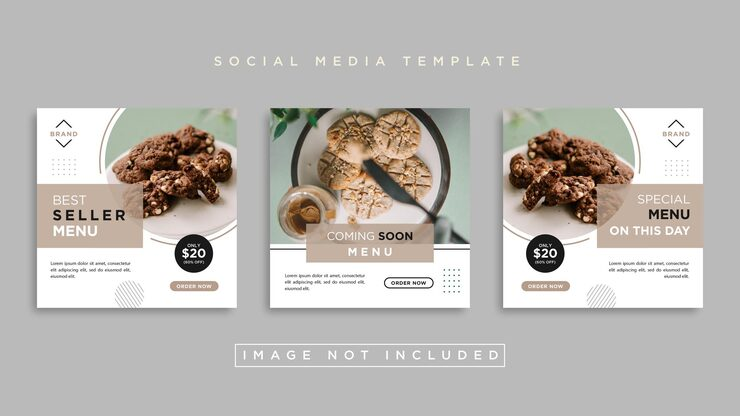

# Cookie menu pack with taupe text bands, black price circles and sage arcs

**Discipline:** print-social · **Design type:** Social template pack · **Design style:** Minimalist
**Tags:** bakery, menu, taupe, sage, price, minimal

## What it is
Three white posts with photos of chocolate and oat cookies inside rounded frames edged by sage arcs, taupe bands with 'BEST SELLER MENU', 'COMING SOON MENU', 'SPECIAL MENU ON THIS DAY', black circles with '$20', diamond brand marks, dot grids and outlined 'Order now' pills.

## What it means
Soft and appetising; neutral taupe lets the baked goods look rich.

## Techniques
- Lay a taupe text band across the photo edge.
- Put the price in a black circle badge.
- Frame photos with a partial coloured arc.
- Keep ornaments tiny: dots and a diamond logo.

## Best for
- Bakeries
- Café menus
- Food delivery posts

## Vocabulary
- **Text band** — A strip of colour holding a title.
- **Price badge** — A circle showing the price.
