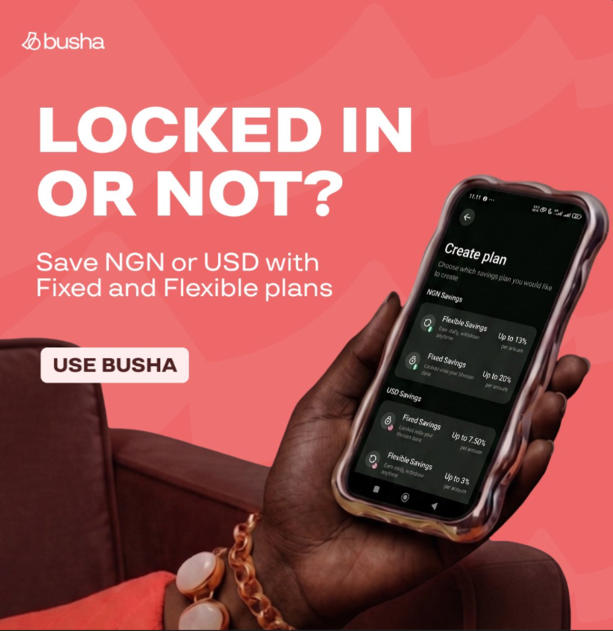

# Locked In or Not Savings Ad in Coral

**Discipline:** print-social · **Design type:** Social ad
**Tags:** ad, coral, white-type, hand-held-phone, sofa, savings, heavy-caps, pill-cta

## What it is
A square coral ad with faint mountain shapes and a logo, a giant white heavy caps headline 'LOCKED IN OR NOT?', a lighter line 'Save NGN or USD with Fixed and Flexible plans', a cream pill 'USE BUSHA', and a dark hand with a chain bracelet holding a phone with a wavy bezel showing a savings plans screen against a maroon sofa.

## What it means
Warm coral and a maroon sofa make a savings product feel cosy, and a punny headline gives it personality.

## Techniques
- Giant heavy caps headline with a question
- Hand-held phone rotated diagonally
- Tonal maroon sofa behind the hand
- Cream pill CTA
- Faint pattern in the coral ground

## Best for
- Savings and fintech app ads
- Pun-led headlines
- Warm single-colour social ads

## Vocabulary
- **Pun headline** — A headline using wordplay tied to the product.
- **Wavy bezel** — A phone case with rippled edges.
- **Tonal background** — A background in a related shade to the main colour.
