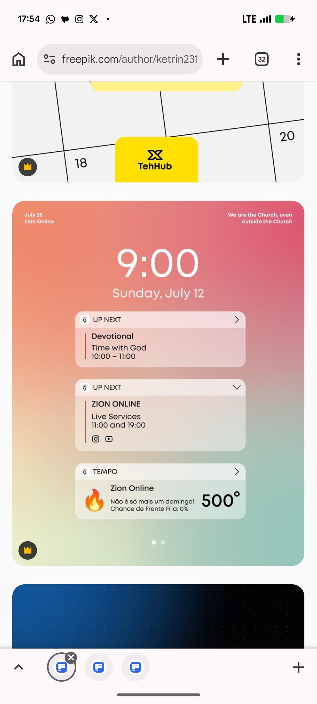

# Coral-to-Teal Lock Screen Widget Post

**Discipline:** print-social · **Design type:** Social ad
**Tags:** lock-screen, widgets, gradient, coral, teal, notifications, church, vector

## What it is
A square post styled as a phone lock screen on a coral-to-teal gradient with a huge white 9:00 clock, a date, three frosted widgets (Up next Devotional, Zion Online live services with social icons, and a weather-style Tempo card with a flame and 500°) and small captions at the top corners.

## What it means
Imitating a lock screen makes an announcement feel native to the phone, and the warm gradient feels welcoming.

## Techniques
- Lock-screen layout used as a post
- Frosted widgets with translucent fill
- Huge light clock numerals
- Warm coral to teal gradient
- Emoji-like flame icon for character

## Best for
- Schedule and service announcements
- Faith and community content
- UI-mimicking social posts

## Vocabulary
- **Lock-screen mockup** — A layout imitating a phone's locked display.
- **Frosted widget** — A translucent card imitating an operating-system widget.
- **UI mimicry** — Designing a post to look like a familiar interface.
