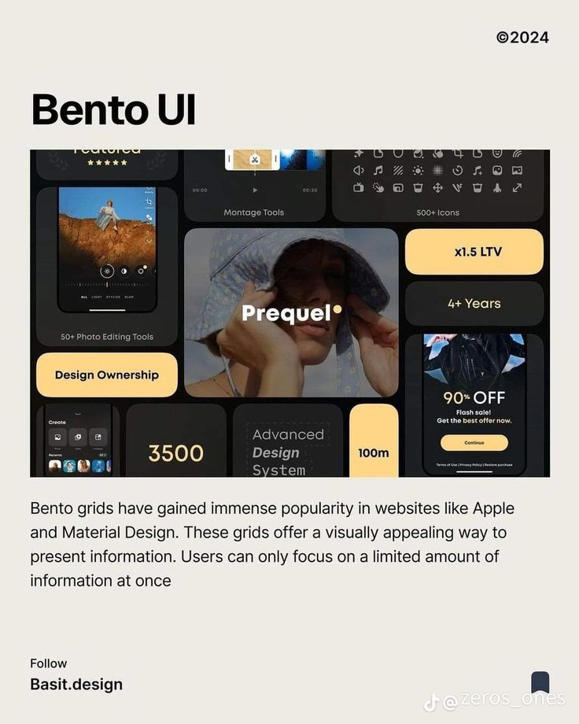

# Bento UI Explainer Post

**Discipline:** print-social · **Design type:** Social educational post
**Tags:** bento, explainer, cream, black, yellow, grid, educational

## What it is
A cream post with a bold black 'Bento UI' title over a screenshot of a dark bento grid (photo, phones, icons, yellow stat chips) and a paragraph explaining bento grids, with a follow handle at the foot.

## What it means
The example is the lesson: a dense dark bento contrasted with a calm cream frame makes the technique easy to recognise.

## Techniques
- Cream frame around a dark example to isolate it
- Yellow chips as the accent inside the bento
- Bold title above the image, short paragraph below
- Mixed tile types (photo, phone, icon grid, number)
- Minimal footer with a follow prompt

## Best for
- Explaining UI trends
- Design education accounts
- Screenshot-led carousels

## Vocabulary
- **Bento grid** — A layout of uneven rounded tiles each holding one item.
- **Example frame** — A neutral border that separates a sample from its explanation.
- **Stat chip** — A small pill holding a number and label.
