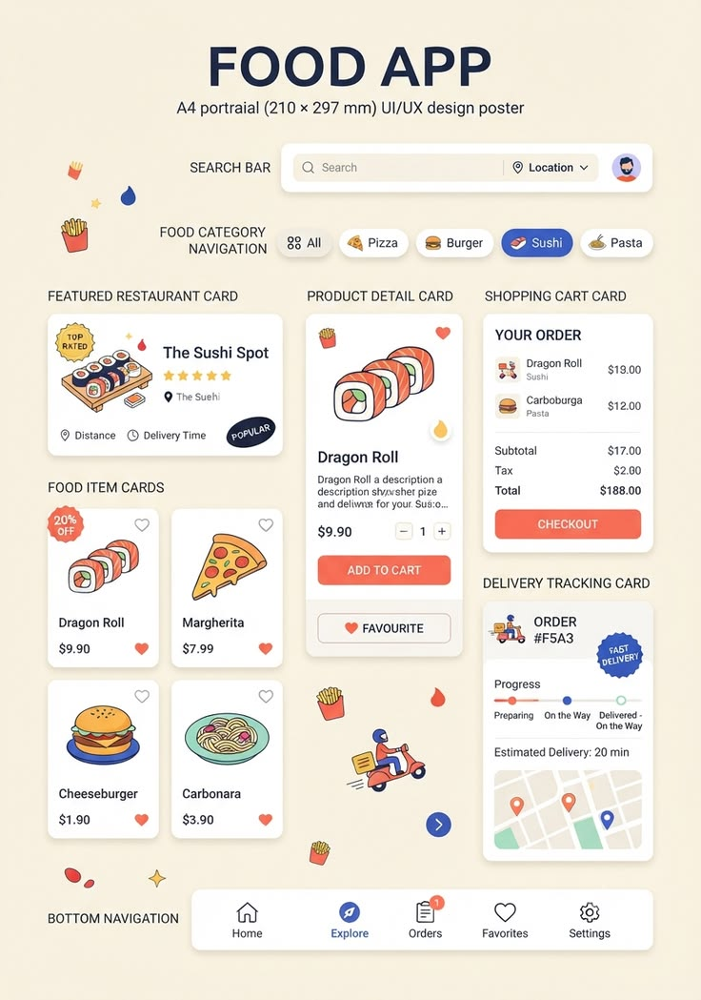

# Food App UI/UX Poster with Labelled Components

**Discipline:** print-social · **Design type:** Product infographic set
**Tags:** food-app, poster, cream, illustrated, components, labels, coral

## What it is
A cream A4-style poster titled 'FOOD APP' with labelled components: search bar, category pills, featured restaurant card, food item cards, product detail card, shopping cart, delivery tracking and bottom navigation, decorated with illustrated food, fries and a scooter rider.

## What it means
Labels on the left name every component, and playful food illustrations keep the technical sheet friendly.

## Techniques
- Component names as left-aligned labels
- Hand-drawn style food illustrations
- Coral primary buttons on white cards
- Scattered sparkles and fries as decoration
- Cream ground with navy title

## Best for
- UI component overview posters
- Food delivery app presentations
- Educational design sheets

## Vocabulary
- **Component sheet** — A board showing each UI component with a name.
- **Delivery tracker** — A card with progress steps and a map.
- **Bottom navigation** — A bar of tabs at the bottom of a mobile screen.
