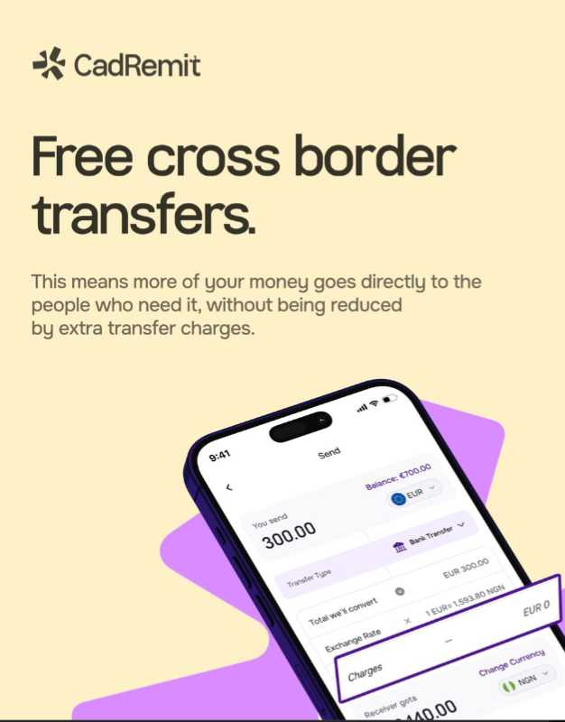

# Free Cross-Border Transfers Ad with Tilted Phone

**Discipline:** print-social ·  · **Design style:** Warm & Organic
**Tags:** ad, cream, lilac, tilted-phone, fintech, highlight-box, transfers, heavy-sans

## What it is
A cream portrait ad with a small logo, a big dark 'Free cross border transfers.' headline, a paragraph about fees, and a phone tilted from the bottom over a lilac blob showing a transfer form where the Charges row 'EUR 0' is boxed in a purple outline that breaks out of the screen.

## What it means
Pulling the Charges row out of the screen with an outline proves the claim visually and points the eye.

## Techniques
- Highlight box breaking out of the phone screen
- Cream ground with one lilac shape
- Large tight sans headline
- Tilted phone cropped by the bottom edge
- Short supporting paragraph

## Best for
- Fee and pricing claims for fintech
- Feature ads with UI proof
- Cream and lilac brand systems

## Vocabulary
- **Breakout highlight** — An outline that extends past the device to emphasise part of the UI.
- **Cropped device** — A phone cut off by the edge of the layout.
- **Proof shot** — A UI image used to back a claim.
