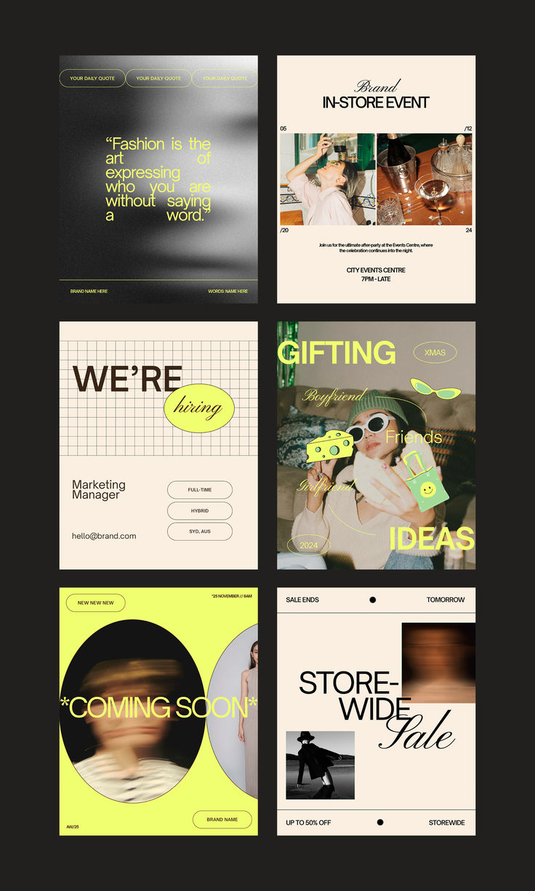

# Cream and Lime Fashion Template Set

**Discipline:** print-social · **Design type:** Social template pack
**Tags:** fashion, cream, lime, editorial, serif-script, grain, templates

## What it is
Six portrait templates on black: a grainy quote card, an in-store event card, a hiring post on grid paper, a gifting collage, a blurred 'Coming soon' oval frame and a sale post.

## What it means
Cream, black and acid-lime feel fashionable and editorial, while blur, grain and script accents feel current.

## Techniques
- Pair heavy sans with italic script for contrast
- Acid-lime as a single accent across all templates
- Motion blur on portraits for movement
- Oval photo masks and grid backgrounds as variety
- Small metadata captions and rules like a magazine

## Best for
- Fashion and retail brands
- Template marketplaces
- Consistent multi-purpose social kits

## Vocabulary
- **Script accent** — An italic script word set within a sans headline.
- **Motion blur portrait** — A photo with deliberate blur to suggest movement.
- **Template family** — Layouts sharing type and color but differing in structure.
