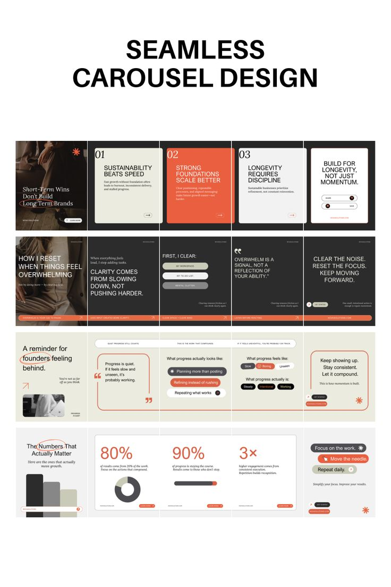

# Seamless carousel system in charcoal, cream and burnt orange with serif italics and hand-drawn ellipses

**Discipline:** print-social ·  · **Design style:** Editorial
**Tags:** carousel, seamless, charcoal, cream, orange, serif, pill-chips, business

## What it is
A pin preview titled 'SEAMLESS CAROUSEL DESIGN' with four rows of five connected slides that read as one long strip: a photo cover, numbered cards, quote panels, chip lists, a bar chart, big stats (80%, 90%, 3x) and hand-drawn orange ellipses around key words.

## What it means
Professional and editorial; the connected slides invite swiping.

## Techniques
- Design slides that continue across their edges.
- Circle key words with a hand-drawn orange ellipse.
- Mix serif italics with sans headlines.
- Use chips and stat cards for variety.

## Best for
- Founder and business carousels
- Editorial consulting content
- Seamless swipe designs

## Vocabulary
- **Seamless carousel** — Slides whose elements continue across boundaries.
- **Hand-drawn ellipse** — A loose oval around a word.
- **Stat slide** — A slide built from big percentages.
- **Chip list** — Options shown as capsules.
