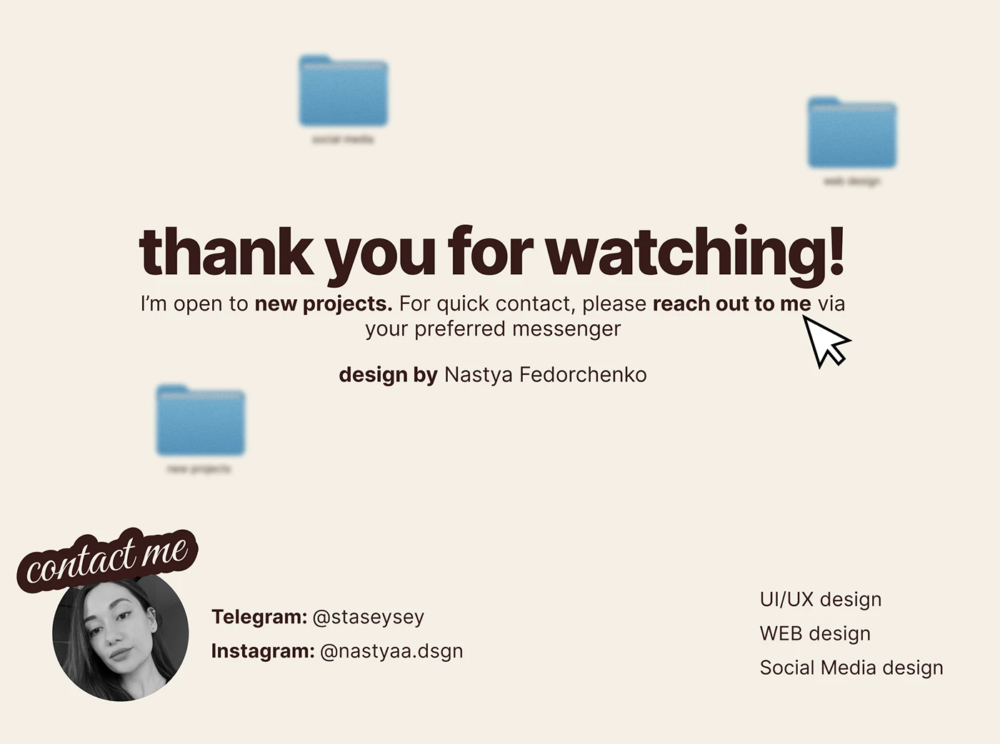

# Thank-you slide with heavy sans, blurred folders and a contact sticker

**Discipline:** print-social · **Design type:** Presentation slides
**Tags:** closing-slide, cream, brown, blurred-folders, cursor, contact, sticker, script

## What it is
A cream slide with a bold chocolate 'thank you for watching!' headline, a paragraph with bold phrases, a big cursor arrow, three heavily blurred blue folders floating in the background, and a greyscale portrait with a 'contact me' script sticker with handles and a list of services.

## What it means
Warm and approachable; blurred folders keep the desktop theme without distracting.

## Techniques
- Blur desktop icons in the background as texture.
- Use a real cursor pointing at the call to action.
- Attach an outlined script sticker to a portrait.
- Bold key phrases inside a friendly paragraph.

## Best for
- Portfolio closing slides
- Freelancer contact pages
- Presentations with a desktop theme

## Vocabulary
- **Blurred icons** — Out-of-focus interface elements used as decoration.
- **Contact sticker** — A script label attached to a portrait.
- **Cursor callout** — A cursor icon pointing to text.
- **Closing slide** — The final slide with thanks and contact.
