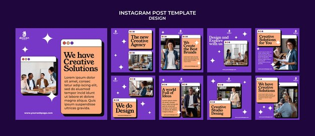

# Creative agency pack on violet with peach browser-window cards and white sparkles

**Discipline:** print-social · **Design type:** Social template pack · **Design style:** Retro & Pixel
**Tags:** agency, design, violet, peach, browser-window, sparkles

## What it is
Nine violet posts with peach and white cards styled like browser windows with three dots and hard black drop shadows, serif headlines ('We have Creative Solutions'), team photos inside the windows, and white four-point sparkles.

## What it means
Playful and design-savvy; retro window frames nod to digital work with charm.

## Techniques
- Frame content as browser windows with dot controls.
- Use hard offset shadows for a retro feel.
- Sprinkle four-point sparkles on a solid field.

## Best for
- Design agencies
- Creative studios
- Web services

## Vocabulary
- **Browser window** — A frame mimicking a web browser's title bar.
- **Hard shadow** — A solid, unblurred offset shadow.
