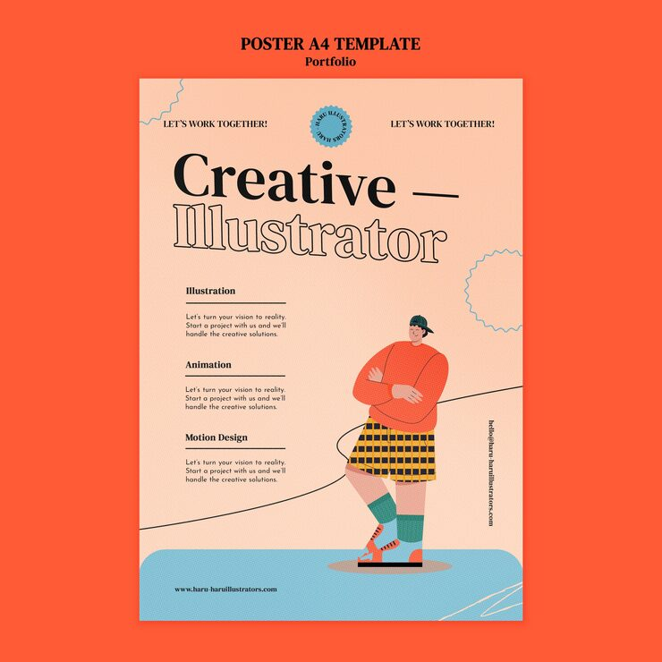

# 'Creative — Illustrator' portfolio poster with an orange field, a flat character and a circular seal badge

**Discipline:** print-social · **Design type:** Poster · **Design style:** Playful & Illustrated
**Tags:** portfolio, illustrator, orange, seal-badge, flat-character, poster

## What it is
An orange-bordered poster with bold black-and-outline 'Creative — Illustrator' title, a small circular scalloped seal badge, three service headings (Illustration, Animation, Motion Design) with short descriptions, a flat-illustrated character in a striped skirt and rollerblades, and squiggly line doodles.

## What it means
Friendly and characterful; a whimsical illustrated figure makes a personal portfolio poster memorable and distinctly the artist's own style.

## Techniques
- Mix solid and outline type for a two-tone headline.
- Use a scalloped seal badge for a certificate-like credibility touch.
- Add a distinctive character illustration as a personal signature.

## Best for
- Illustrator and artist portfolios
- Personal brand posters
- Playful service listings

## Vocabulary
- **Scalloped seal** — A badge shape with a wavy, stamp-like edge.
- **Signature character** — A recurring illustrated figure representing an artist's style.
