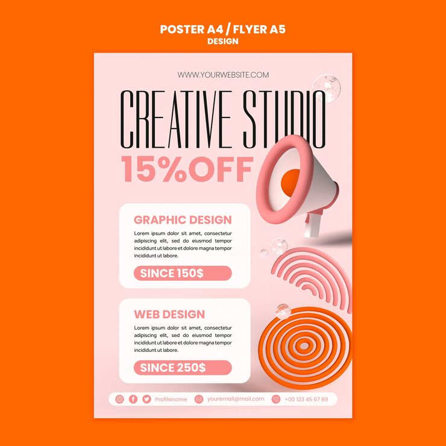

# 'Creative Studio 15% Off' poster with a glossy pink 3D megaphone and concentric ring shapes

**Discipline:** print-social · **Design type:** Poster · **Design style:** 3D & Surreal
**Tags:** agency, peach, 3d-render, megaphone, rings, poster

## What it is
A peach-orange A4 poster with a serif italic 'CREATIVE STUDIO' headline, a bold pink '15% OFF', two rounded white service cards (Graphic Design, Web Design) with pricing pills, a glossy pink 3D megaphone with small floating glass spheres, and concentric orange-pink target rings.

## What it means
Warm and premium; a soft glossy 3D megaphone gives an announcement poster real tactile appeal without feeling loud.

## Techniques
- Render a symbolic object (a megaphone) as a soft glossy 3D form.
- Pair service pricing with rounded white cards on a colour field.
- Add concentric ring shapes as a soft target motif.

## Best for
- Design studio offers
- Agency service pricing
- Soft 3D-accented branding

## Vocabulary
- **Glossy 3D render** — A smooth, reflective computer-generated object.
- **Pricing card** — A card pairing a service name with its price.
