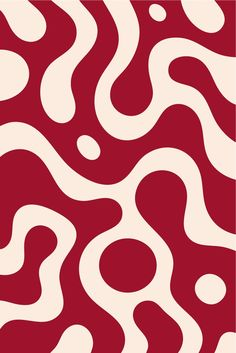

# Two-colour crimson and cream fluid swirl pattern with scattered dots

**Discipline:** print-social ·  · **Design style:** Warm & Organic
**Tags:** pattern, crimson, cream, liquid, organic, retro, two-colour, background

## What it is
A portrait pattern of thick flowing cream ribbons winding through a deep red background, punctuated by cream circles and small dots.

## What it means
Groovy and warm; only two colours keep a busy pattern bold and clean.

## Techniques
- Use thick organic curves in two colours.
- Add circles of varying sizes as punctuation.
- Let shapes bleed off the edges.
- Use it as a wrap, background or packaging pattern.

## Best for
- Packaging and poster backgrounds
- Retro or 70s themes
- Brand pattern systems

## Vocabulary
- **Liquid pattern** — A flowing organic shape pattern.
- **Two-colour print** — Artwork in just two inks.
- **Bleed pattern** — A pattern extending beyond the edges.
- **Dot punctuation** — Small circles breaking up shapes.
