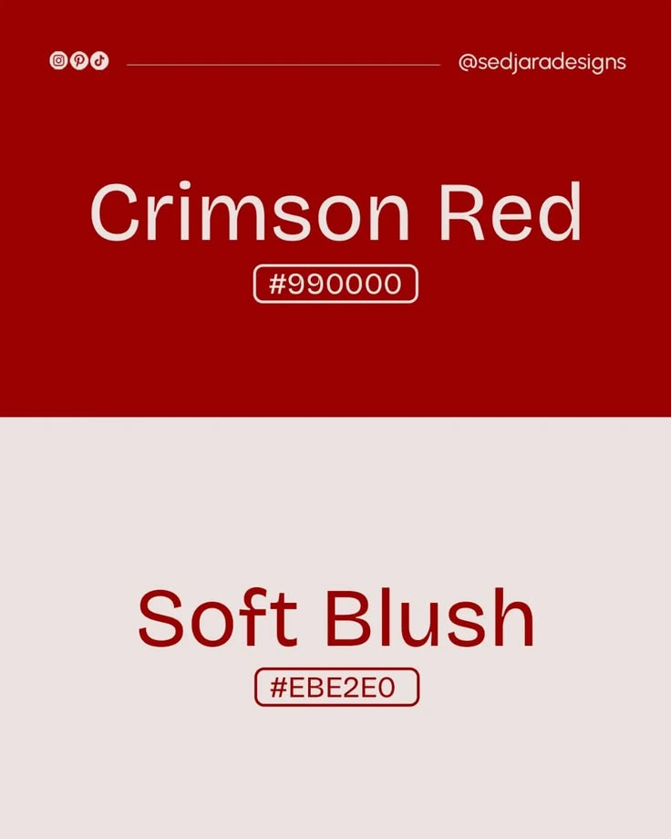

# Crimson Red and Soft Blush Colour Post

**Discipline:** print-social · **Design type:** Social educational post
**Tags:** colour, red, blush, split, hex, minimal, palette

## What it is
A portrait post split into a crimson upper half with blush text 'Crimson Red #990000' and a blush lower half with crimson text 'Soft Blush #EBE2E0', hex codes in outlined pills, and a social handle strip at the top.

## What it means
Each colour is shown on its own field and its partner used as text, demonstrating the pair.

## Techniques
- Swap colours between the halves
- Colour name large and centred
- Hex code in an outlined pill
- Header line with handle and icons
- Only two colours used

## Best for
- Colour palette posts
- Minimal two-colour layouts
- Design inspiration accounts

## Vocabulary
- **Colour pair** — Two colours chosen to work together.
- **Split layout** — A canvas divided into two contrasting halves.
- **Hex pill** — A rounded outline holding a colour code.
