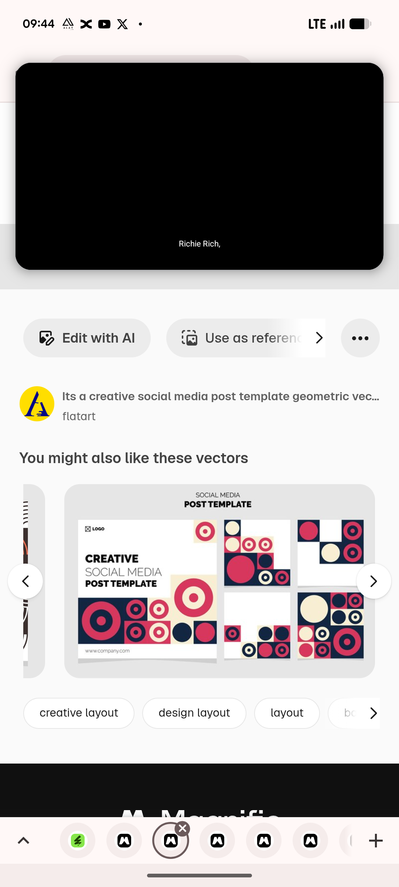

# Geometric Circle Post Template Pack Listing

**Discipline:** print-social ·  · **Design style:** Geometric & Bauhaus
**Tags:** template-pack, geometric, circles, crimson, navy, cream, variants, stock

## What it is
A stock-vector listing page showing a five-piece template pack on light grey: a large post titled 'CREATIVE SOCIAL MEDIA POST TEMPLATE' plus four square variants, each built from crimson, navy and cream blocks holding circles and bullseyes in different arrangements.

## What it means
Showing several arrangements of the same modules proves the system can flex without changing its look.

## Techniques
- One large hero post with four smaller variants
- Same shapes rearranged per post
- Blocks placed at the edges and corners
- Consistent three-colour palette
- White space used as another block

## Best for
- Template pack presentation
- Geometric social systems
- Showing variants of one motif

## Vocabulary
- **Variant set** — Several layouts sharing modules and palette.
- **Module** — A reusable square shape holding a motif.
- **Pack preview** — An image showing all the items in a template pack.
