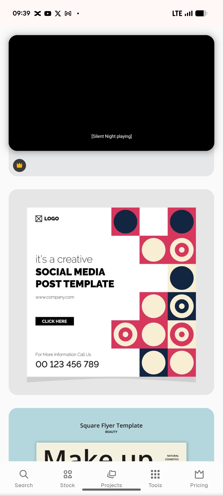

# Crimson, Navy and Cream Circle Grid Template

**Discipline:** print-social · **Design type:** Social template pack
**Tags:** geometric, circles, crimson, navy, cream, square, template, bauhaus

## What it is
A stock-template preview of a square post with a white left half holding a logo, 'it's a creative SOCIAL MEDIA POST TEMPLATE', a URL, a black CLICK HERE button and a phone number, beside a stepped stack of squares in crimson, navy and cream each holding a circle, bullseye or half-disc.

## What it means
A Bauhaus-style grid of simple circles gives a lively, playful pattern from very few shapes.

## Techniques
- Stepped block layout of colour squares
- Circles, rings and dots as the only motifs
- Three-colour palette of crimson, navy and cream
- Light and bold weights mixed in the headline
- Black button as a strong anchor

## Best for
- Geometric social templates
- Bauhaus-inspired promos
- Colour-block pattern designs

## Vocabulary
- **Stepped grid** — Squares arranged in a staircase edge.
- **Bullseye** — A circle with a smaller ring and dot at its centre.
- **Bauhaus geometry** — Design built from basic shapes and primary colours.
