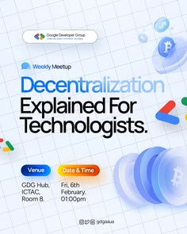

# Decentralization meetup flyer on pale grid paper with 3D coins and coloured pills

**Discipline:** print-social ·  · **Design style:** 3D & Surreal
**Tags:** event, meetup, grid-paper, 3d-coins, bitcoin, pills, blue, chevrons

## What it is
A light blue squared-paper flyer with a Google developer group logo pill, a small Weekly Meetup label, a large two-tone title 'Decentralization Explained For Technologists.' in blue and black, blue and orange pills for venue and date, and glossy translucent 3D coins with Bitcoin symbols and colourful chevrons at edges.

## What it means
Friendly and technical; glassy coins give an abstract topic a tangible object.

## Techniques
- Colour the first word blue and the rest black in the title.
- Use translucent 3D coins as topical objects.
- Rest the objects on grid paper.
- Turn details into gradient pills.

## Best for
- Tech community meetups
- Crypto and web3 events
- Weekly series flyers

## Vocabulary
- **Two-tone title** — A headline with part in an accent colour.
- **Glass coin** — A translucent 3D coin.
- **Series flyer** — A repeated layout for weekly events.
- **Gradient pill** — A capsule filled with a gradient.
