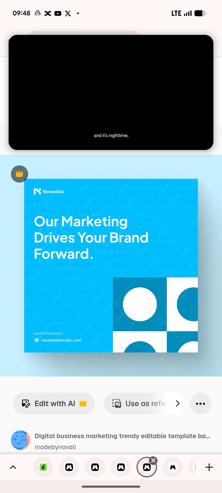

# Cyan Post with Circle Block Corner

**Discipline:** print-social · **Design type:** Social template pack
**Tags:** cyan, blue, circles, corner-pattern, marketing, square, template, white-type

## What it is
A saturated cyan square post with a small logo, a large white headline 'Our Marketing Drives Your Brand Forward.', a website line at the lower left and a corner block pattern of white and deep-teal squares holding circles and quarter circles, on a pale blue backdrop with a soft shadow.

## What it means
Big white type on cyan reads instantly, and the corner pattern adds interest without stealing the message.

## Techniques
- Solid cyan field with white headline
- Block pattern anchored to a single corner
- Two tones of the same hue for shapes
- Small logo top left and site at the base
- Drop shadow lifting the post from the backdrop

## Best for
- Marketing agency posts
- Single-colour templates with a corner motif
- Cyan brand systems

## Vocabulary
- **Corner motif** — A pattern placed in one corner of a canvas.
- **Monochrome shapes** — Shapes coloured in tints of the background hue.
- **Drop shadow** — A soft shadow under an object.
