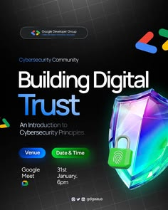

# Cybersecurity event flyer with a holographic shield and pill details

**Discipline:** print-social ·  · **Design style:** Glassmorphism
**Tags:** event, flyer, tech, dark, holographic, 3d-shield, pills, google-colours

## What it is
A dark navy portrait flyer with the title 'Building Digital Trust' (last word in blue), a subtitle, two pill buttons (Venue, Date & Time) in blue and green, date and location text beneath, and a glossy iridescent 3D shield with a padlock glowing in the corner. Small Google-coloured chevrons float at the edge.

## What it means
Techy, secure and community-friendly; the glossy shield makes an abstract topic tangible.

## Techniques
- Illustrate an abstract idea with one glossy 3D object.
- Turn key details (venue, date) into colourful pills that resemble UI buttons.
- Use one word of the title in a brighter colour for emphasis.
- Keep the dark background subtle with small brand-coloured shapes.

## Best for
- Tech meetups and webinars
- Developer community events
- Announcement posters

## Vocabulary
- **Iridescent 3D** — A glossy render with rainbow-like reflections.
- **Detail pill** — A rounded label showing event info.
- **Hero object** — One large object representing the theme.
- **Dark tech flyer** — A dark-background event design.
