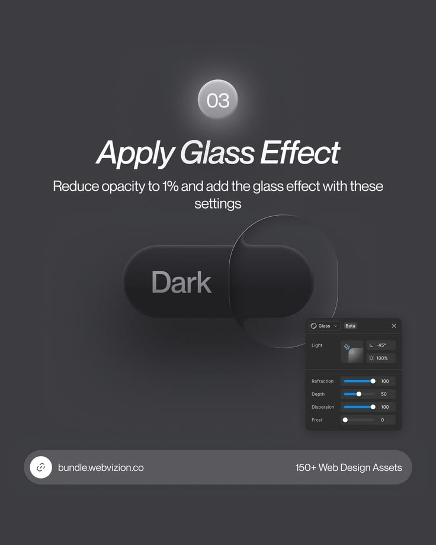

# Apply Glass Effect Tutorial Post

**Discipline:** print-social · **Design type:** Social educational post
**Tags:** tutorial, glass, dark, settings-panel, toggle, step-03

## What it is
Step 03 of a dark-mode toggle tutorial: a glowing number bubble, italic title, short instruction, a dark toggle with a clear glass bubble and a floating glass settings panel with sliders.

## What it means
Showing the actual settings panel turns a tip into reproducible steps, and the dark neutral scene keeps focus on the glass.

## Techniques
- Number bubble with halo glow as a step marker
- Clear glass shape refracting a dark pill
- Floating property panel beside the demo
- Italic headline for movement
- Pill link bar as a recurring footer

## Best for
- UI effect tutorials
- Design asset promotion
- Step-by-step carousels

## Vocabulary
- **Refraction** — Bending of light through glass, imitated in UI glass effects.
- **Property panel** — A design tool's settings box shown as a teaching aid.
- **Series footer** — A repeated bottom bar across slides.
